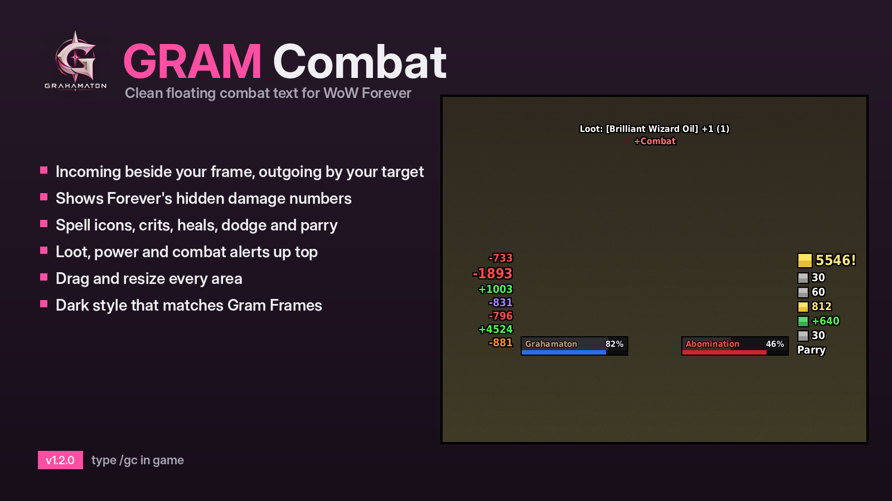
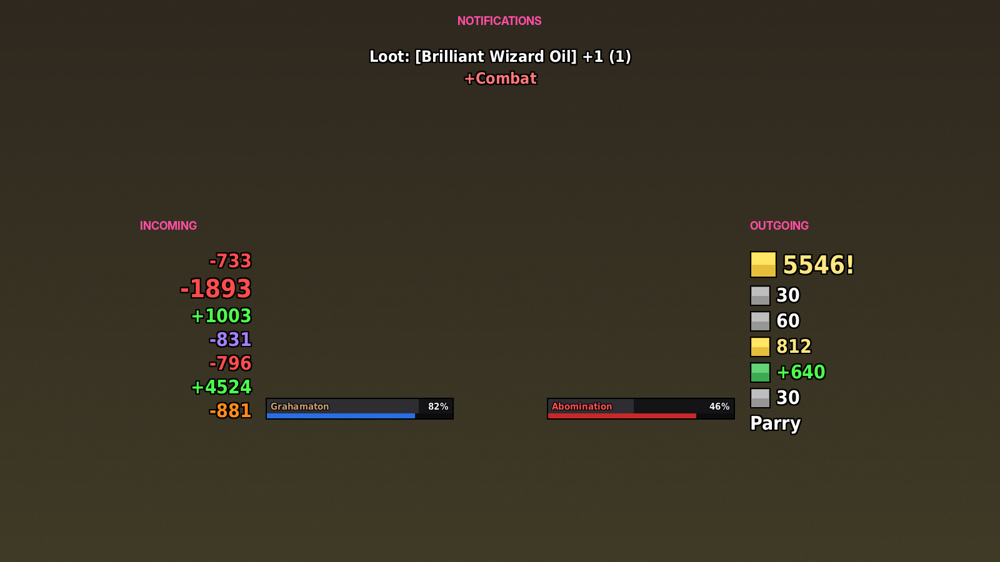
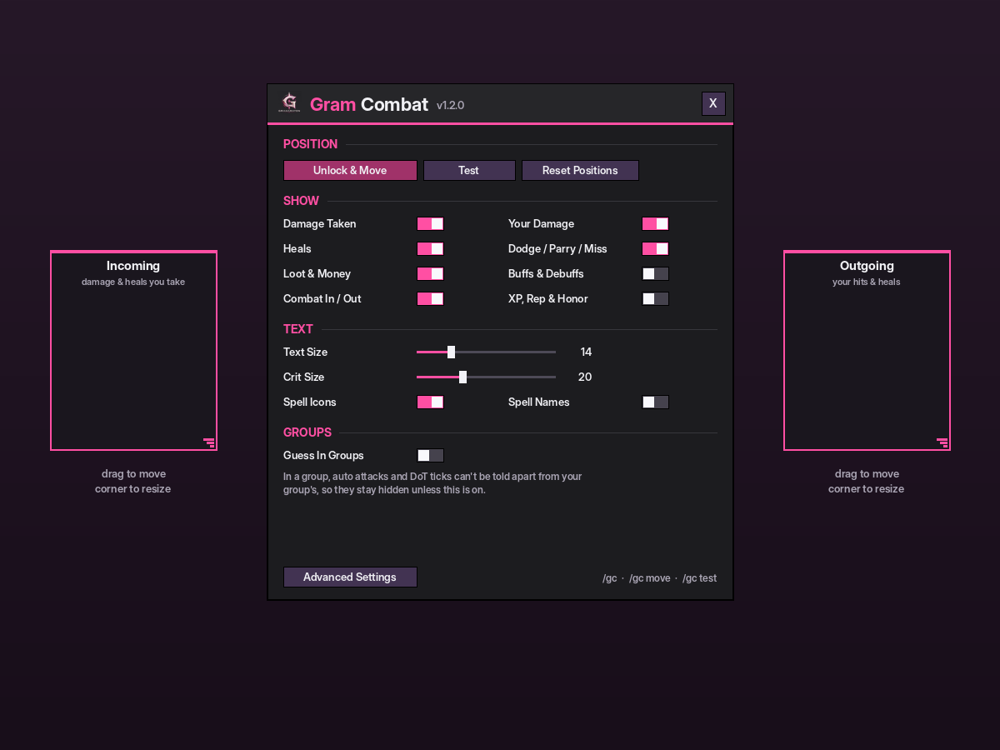

# Gram Combat

Clean floating combat text for **WoW Forever**. Made to sit next to Gram Frames.

**Version 1.2.1** · Interface 16001 · type `/gc` in game

## Install
1. **[Download GramCombat.zip](https://github.com/jonathanwehman/gramcombat/raw/main/GramCombat.zip)**, or get it from CurseForge.
2. Unzip it into `World of Warcraft\_forever_\Interface\AddOns` so you get `AddOns\GramCombat`.
3. Log in, type `/gc`, hit **Unlock & Move**, drag and resize the pink boxes, then **Lock**.

## Layout

- **Incoming**: bottom left, against your player frame
- **Outgoing**: bottom right, with spell icons
- **Notifications**: loot, power, buffs and combat alerts up top

## Settings

`/gc` panel · `/gc move` move & resize · `/gc test` fake hits · `/gc advanced` every setting · `/gc debug` show what the game sends

## On Forever
Forever hides combat details from addons. Gram Combat shows the real damage
numbers anyway, but in a group your auto attacks and DoT ticks can't be told
apart from your group's, so they stay hidden unless you turn on "Guess In Groups".

## Thanks
Built on Parrot 2 by ckknight, Neb and profalbert, under the LGPL v2.1 (see LICENSE.txt).
